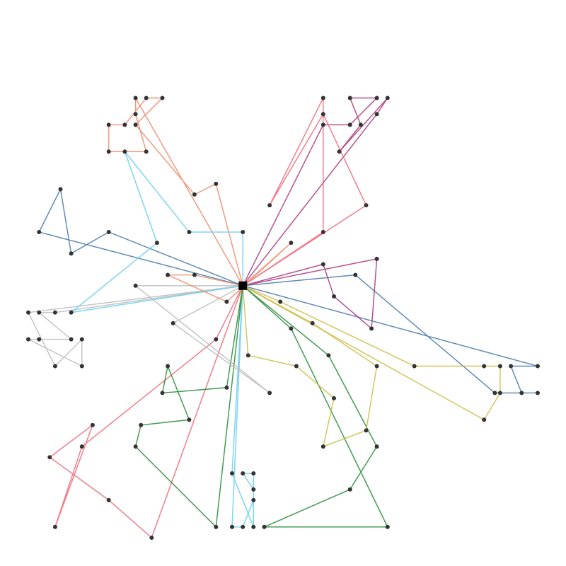

# Clowder

Delivery route planning for a small fleet. Keep depots, vehicles, drivers and consignments; then ask
it to turn a day's work into routes that respect capacity, time windows and shift lengths — and prove
the routes it returns are actually feasible.

The planner is a Solomon I1 construction heuristic followed by local search, benchmarked against the
published Solomon VRPTW instances so the quality claim is checkable rather than asserted.

Java 21 · Spring Boot 4 · PostgreSQL 17 · Flyway · Testcontainers



*Solomon RC101 — 100 customers, 16 routes, 1809.27 units, 22 ms. Rendered by the application itself;
see `POST /api/plan-runs/svg`.*

---

## Quick start

```bash
docker compose up -d
./mvnw spring-boot:run
```

Then import a benchmark instance and plan it:

```bash
# 1. Load 100 customers, 25 vehicles and a depot from a Solomon instance file
curl -X POST localhost:8080/api/import/solomon \
  -H 'Content-Type: text/plain' \
  --data-binary @benchmarks/solomon-100/In/rc101.txt

# 2. Plan that depot-day. Use the depotId the import returned.
curl -X POST localhost:8080/api/plan-runs \
  -H 'Content-Type: application/json' \
  -d '{"depotId":1,"serviceDate":"2026-01-05","budgetSeconds":5}'

# 3. The same run as a picture
curl -X POST localhost:8080/api/plan-runs/svg \
  -H 'Content-Type: application/json' \
  -d '{"depotId":1,"serviceDate":"2026-01-05","budgetSeconds":5}' > routes.svg
```

A plan run comes back with one entry per vehicle, each stop carrying the arrival, service start and
departure the feasibility engine computed for it, plus any consignments no vehicle could take.

## The API

| Method | Path | What it does |
| --- | --- | --- |
| `GET POST` | `/api/depots`, `/api/depots/{id}` | Depot list, create, read |
| `GET POST PUT DELETE` | `/api/vehicles` | Vehicle CRUD; `DELETE` deactivates |
| `GET POST PUT DELETE` | `/api/drivers` | Driver CRUD; `DELETE` deactivates |
| `GET POST` | `/api/consignments` | Create and list by `serviceDate`, optional `depotId` |
| `POST` | `/api/consignments/{id}/transitions` | Move one consignment through its lifecycle |
| `POST` | `/api/import/solomon` | Import a raw Solomon instance file as `text/plain` |
| `POST` | `/api/plan-runs` | Solve a depot-day, return routes and schedules |
| `POST` | `/api/plan-runs/svg` | The same solve, rendered |

Errors are RFC 9457 problem documents throughout — `type`, `title`, `status`, `detail`, and
field-level `errors` on a validation failure.

## How it fits together

```
fleet         depots, vehicles, drivers        ─┐
consignment   orders, windows, state machine   ─┤ cross a module boundary only through a facade,
importer      Solomon instance files           ─┘ by id, never by entity
planning
  model       flat problem: specs + matrix        no Spring, no JPA, no transaction
  feasibility RouteEvaluator: every violation     enforced by an ArchUnit rule
  solver      I1 construction + local search
  render      SVG
  plan        the edge: entities ⇄ solver, and the HTTP resource
```

Two rules carry most of the structure:

- **Entities never leave their module.** A consignment holds `depotId` as a plain `Long`, not a
  `@ManyToOne Depot`, so `consignment` can never navigate into `fleet`'s object graph. An ArchUnit
  rule fails the build if it tries.
- **The planning core is plain Java.** `model`, `feasibility`, `solver`, `bench` and `render` may not
  import Spring, JPA or bean validation. That is why the solver is testable without a container and
  why its whole test suite runs in well under a second. `planning.plan` is deliberately outside that
  rule: translating at the edge is its job.

The separation between *evaluating* a route and *searching* for one is the load-bearing decision.
`RouteEvaluator` reports every violation of a given route and is the independent check; the solver
has a faster allocation-free twin for its inner loop, and a test asserts the two never disagree on
random routes. Every route the solver returns is re-run through the evaluator before it is handed
back, so an infeasible plan cannot ship.

## Building and testing

```bash
./mvnw test     # 111 unit tests, no Docker needed
./mvnw verify   # the above plus 44 integration tests on Testcontainers; needs Docker
```

Naming decides the runner: `*Test` runs under Surefire and must not touch a database; `*IT` runs
under Failsafe and may.

## Benchmarks

The solver is scored against the published best-known solutions for M. M. Solomon's VRPTW benchmark
set — 56 instances of 100 customers each, the standard yardstick for this problem since 1987. The
instance files are committed under `benchmarks/` so the numbers below are reproducible; see
[`benchmarks/README.md`](benchmarks/README.md) for provenance and how to rebuild the table. Full
per-instance results are in [`benchmarks/results.csv`](benchmarks/results.csv).

**All 56 instances, 5 s budget each:**

| | |
| --- | --- |
| Mean distance gap | **+9.9%** over best-known (median +9.2%) |
| Matched best-known distance exactly | **8** instances |
| Matched best-known vehicle count | 17 of 56 |
| Vehicles over best-known | 58 across 56 instances |
| Consignments left unrouted | **0** |
| Solve time | 2–34 ms per instance |

By family, where series 1 has tight windows and series 2 a long horizon:

| Family | C1 | C2 | R1 | R2 | RC1 | RC2 |
| --- | --- | --- | --- | --- | --- | --- |
| Mean gap | +5.5% | +9.2% | +7.8% | +14.3% | +7.6% | +15.0% |

Read honestly:

- **Hitting best-known exactly on eight clustered instances** is the result worth trusting. It is
  hard to land on a published optimum by accident, so it says the distance arithmetic, the window
  semantics and the feasibility rules all agree with the literature rather than merely looking
  plausible. (`C101` and friends show a gap of `-0.00%`: that is floating-point noise on an exact
  match, not an improvement on the best known.)
- **Vehicle count is the weak spot.** Roughly one extra vehicle per instance, and vehicle count is
  the *first* term of the objective, so it costs more than the distance gap does. Relocate is not
  emptying routes hard enough.
- **Series 2 is twice as bad as series 1.** Long horizons mean long routes, and first-improvement
  2-opt and Or-opt only partially explore a large neighbourhood before converging.
- **It converges in milliseconds and then idles** for the remaining 5 seconds. That unspent budget
  is the headroom: perturbation and restarts would use it. Measure before adding, in that order.

## Decisions worth knowing

**Pagination is offset-based** (`?page=&size=`, default 50). Fine at the scale this targets — a
depot-day is hundreds of rows, not millions — but `OFFSET` makes deep pages progressively more
expensive and can skip or repeat rows when data changes between requests. Cursor pagination is the
fix and is not implemented.

**Distances are integers in a provider-defined minor unit** — millionths of a plane unit for Solomon
instances, whole metres for real geography — so route totals accumulate exactly rather than in
floating point.

**Travel times are rounded to whole minutes.** Published Solomon results use real-valued times, so
the gap column compares integer-time solutions against real-time best-knowns. The rounding makes time
windows marginally harder to satisfy, so it cannot flatter these results.

**Time windows are closed.** Starting service exactly at the window end is feasible, and service may
run past it — standard VRPTW constrains the *start* of service, not its finish. Arriving early and
waiting is normal operation, not a violation.

**The objective is lexicographic:** fewest unrouted consignments, then fewest vehicles, then shortest
distance. Reversing the last two makes the numbers comparable to nothing.

**Solomon coordinates are plane units, not degrees**, and are stored raw: x as longitude, y as
latitude. `LatLon` enforces ±90 / ±180 and the standard instances sit inside roughly 0–100 on both
axes, so an instance that would fall outside is rejected with an explanatory error rather than
silently clamped. Euclidean distance is translation-invariant, so if that ever trips, subtracting a
constant from every coordinate preserves every published result exactly. These instances must be
measured with Euclidean distance, never haversine — projecting them onto real geography would destroy
benchmark comparability.

**The instance format carries no date**, so imports default to `2026-01-05` with the depot in UTC,
and travel time equals distance (vehicle speed is nominal and unused).

## Status

Working: all four entities with full CRUD and consistent error shapes, the Solomon importer, the
feasibility engine, the solver, the renderer, and the planning endpoint above.

Not done yet, in rough order of how much they would matter:

- **Plans are not persisted.** `POST /api/plan-runs` solves and returns; nothing is stored, so there
  is no plan to publish, version, supersede or compare. That is the next milestone, and it brings the
  partial unique index that makes "one published plan per vehicle per day" a database guarantee
  rather than a convention.
- **No execution tracking.** No driver events, no idempotent ingestion, no divergence between plan
  and reality.
- **The distance model is hard-coded to Euclidean** in the planning loader. Real depots need
  haversine, and the choice belongs per instance, not per build.
- **Depot has no update or deactivate**, because it has no `active` column; inventing the lifecycle
  before something needs it would be a migration for its own sake.
- **`shift_minutes` is capped at 2880**, which rules out Solomon type-2 horizons until a migration
  raises it.
- **No CI and no formatter** wired into the build.
- **No licence file.**

## Credits

Benchmark instances are M. M. Solomon's VRPTW problem set; best-known values are cited in
`benchmarks/best-known.csv`.
